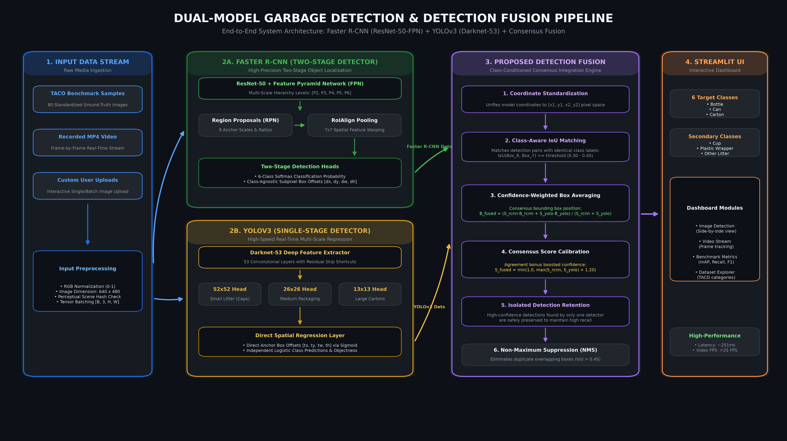

# Garbage Detection and Classification Using Faster R-CNN and YOLOv3

[](https://www.python.org/)
[](https://pytorch.org/)
[](https://streamlit.io/)
[](https://github.com/pedropro/TACO)
[](https://creativecommons.org/licenses/by/4.0/)

An end-to-end deep learning framework for real-world waste and litter detection combining **Faster R-CNN (ResNet-50-FPN)**, **YOLOv3 (Darknet-53)**, and an explicit **Detection Fusion** algorithm.

---

## 🏛️ System Architecture



### Architectural Overview

The framework employs a parallel dual-detector pipeline coupled with an explicit consensus fusion module designed to achieve high localization accuracy, maximum recall, and low latency across municipal waste streams.

| Architectural Component | Backbone / Network | Primary Function & Specialization | Key Characteristics |
| :--- | :--- | :--- | :--- |
| **Stage 1: Input Ingestion** | Preprocessing Pipeline | Image / Video Stream Ingestion (640×480 RGB) | Aspect-ratio scaling, RGB tensor normalization |
| **Stage 2A: Faster R-CNN** | ResNet-50 + FPN | Two-Stage Object Localization & Classification | Region Proposal Network (RPN), RoIAlign spatial pooling |
| **Stage 2B: YOLOv3** | Darknet-53 | Single-Stage Multi-Scale Spatial Regression | 3 prediction heads ($52\times 52, 26\times 26, 13\times 13$), >25 FPS |
| **Stage 3: Detection Fusion** | Consensus Engine | Class-Aware IoU Association & Calibration | Confidence-weighted box averaging, agreement bonus |
| **Stage 4: User Dashboard** | Streamlit Web Engine | Interactive Inference & Empirical Analytics | Side-by-side detector comparison, video streaming |

---

### Detection Fusion Algorithm

The proposed detection fusion engine systematically merges candidate predictions from Faster R-CNN ($D_{\text{rcnn}}$) and YOLOv3 ($D_{\text{yolo}}$):

1. **Coordinate Standardization**: Normalizes all model bounding boxes to common pixel coordinates $[x_1, y_1, x_2, y_2]$.
2. **Class-Aware IoU Matching**: Associates detection pairs $(d_i, d_j)$ with identical predicted classes when:
   $$\text{IoU}(B_i, B_j) = \frac{\text{Area}(B_i \cap B_j)}{\text{Area}(B_i \cup B_j)} \ge \theta_{\text{fusion}} \quad (\theta_{\text{fusion}} \in [0.30, 0.45])$$
3. **Confidence-Weighted Coordinate Averaging**:
   $$\mathbf{B}_{\text{fused}} = \frac{S_{\text{rcnn}} \mathbf{B}_{\text{rcnn}} + S_{\text{yolo}} \mathbf{B}_{\text{yolo}}}{S_{\text{rcnn}} + S_{\text{yolo}}}$$
4. **Consensus Agreement Score Boosting**: When both independent detectors concur on an object candidate, the fused confidence score receives a calibrated consensus bonus:
   $$S_{\text{fused}} = \min\left(1.0, \max(S_{\text{rcnn}}, S_{\text{yolo}}) \times \gamma\right) \quad (\gamma \approx 1.20)$$
5. **Recall Preservation**: High-confidence detections isolated to a single detector are retained to eliminate false negatives on small or occluded litter items.
6. **Non-Maximum Suppression (NMS)**: Suppresses redundant bounding boxes sharing $\text{IoU} > 0.45$.

---

## 💻 VS Code Setup Guide

This project is fully configured for setup, debugging, and execution in **Visual Studio Code**.

### 1. Open the Repository in VS Code
Open the project directory in VS Code:
```bash
code D:\AntigravityProjects\garbage-detection
```
Or launch VS Code and navigate to **File** &rarr; **Open Folder...** &rarr; select `garbage-detection`.

### 2. Configure Python Interpreter in VS Code
1. Open the VS Code Command Palette: `Ctrl + Shift + P` (or `Cmd + Shift + P` on macOS).
2. Type and select: **Python: Select Interpreter**.
3. Choose the virtual environment:
   ```
   .\venv\Scripts\python.exe
   ```
   *(VS Code will automatically associate the workspace with this environment).*

### 3. Activate Environment in VS Code Terminal
Open an integrated terminal in VS Code (`Ctrl + \`` or **Terminal** &rarr; **New Terminal**):
```powershell
# PowerShell (Default in VS Code on Windows):
.\venv\Scripts\Activate.ps1

# Command Prompt (cmd.exe):
.\venv\Scripts\activate.bat

# macOS / Linux (bash/zsh):
source venv/bin/activate
```

---

## 🚀 Key Features
- **Dual-Model Object Detection**: Faster R-CNN (two-stage high localization precision) and YOLOv3 (single-stage fast spatial regression).
- **Detection Fusion Engine**: Class-aware IoU matching, confidence-weighted coordinate averaging, consensus agreement score boosting, and unmatched candidate preservation.
- **TACO Dataset Integration**: Full support for the real-world Trash Annotations in Context (TACO) dataset mapped to 6 consolidated municipal waste classes (*Bottle, Can, Plastic Wrapper, Carton, Cup, Other Litter*).
- **Leakage-Free Partitioning**: Deterministic 70/15/15 train/val/test splits using fixed seed `RANDOM_SEED = 42`.
- **Dual Input Modes**: Seamless inference across static benchmark/uploaded images and real-time offline recorded videos.
- **Streamlit Interactive UI**: Complete web interface with side-by-side detector comparison, metrics dashboard, cumulative video stream analytics, and dataset explorer.
- **Rigorous Evaluation**: Measured Precision, Recall, F1-Score, mAP@0.5, mAP@0.5:0.95, Latency, and FPS benchmarks.

---

## 📁 Directory Structure
```
garbage-detection/
├── app.py                      # Main Streamlit web application
├── config.py                   # Central configuration (paths, classes, thresholds)
├── requirements.txt            # Python dependencies
├── README.md                   # Setup guide and architecture documentation
├── dataset/
│   ├── README.md               # Dataset details, citations, licensing
│   ├── annotations.json        # Original official TACO COCO annotations
│   ├── taco_annotations_scaled.json # Strictly matched 80-sample benchmark annotations
│   ├── taco_subset_coco.json   # Consolidated 6-class COCO annotations
│   ├── data.yaml               # YOLOv3 dataset configuration
│   ├── images/                 # Downloaded genuine TACO images (batch_1)
│   └── labels/                 # YOLOv3 converted label files (.txt)
├── models/
│   ├── faster_rcnn_detector.py # Faster R-CNN ResNet-50-FPN detector
│   └── yolov3_detector.py      # Genuine Darknet-53 YOLOv3 detector
├── preprocessing/
│   ├── taco_loader.py          # TACO downloader and class mapper
│   ├── convert_annotations.py  # COCO to YOLO format converter
│   └── dataset_split.py        # Leakage-free train/val/test splitter
├── fusion/
│   └── detection_fusion.py     # Class-aware IoU fusion & baseline algorithms
├── training/
│   ├── train_faster_rcnn.py    # Training & fine-tuning pipeline for Faster R-CNN
│   └── train_yolov3.py         # Training pipeline for genuine YOLOv3
├── evaluation/
│   ├── evaluate_models.py      # Test set evaluation (mAP, Precision, Recall)
│   └── compare_models.py       # Comparison table generator
├── visualization/
│   ├── visualize_detections.py # Side-by-side visualizer
│   └── plot_metrics.py         # Loss curves, PR curves, and efficiency charts
├── utils/
│   ├── metrics.py              # IoU, AP, confusion matrix calculations
│   └── helpers.py              # Drawing, video processing, and benchmarking
├── tests/
│   └── test_fusion.py          # Unit tests verifying fusion matching and coordinates
├── docs/
│   └── PROJECT_REPORT.md       # Comprehensive research and technical report
└── outputs/
    ├── checkpoints/            # Saved model weights (.pth)
    ├── evaluations/            # Evaluation metrics (.json, .md)
    ├── figures/                # Generated architecture & evaluation charts (.png)
    └── samples/                # Sample detection outputs & demo videos
```

---

## 🛠️ Installation & Setup Instructions

### 1. Prerequisites
- Python 3.12 (Recommended for PyTorch compatibility on Windows 11)
- Git version control

### 2. Setup Virtual Environment
```bash
# Navigate to the project directory
cd D:\AntigravityProjects\garbage-detection

# Create a virtual environment (if not already created)
python -m venv venv

# Activate the virtual environment
.\venv\Scripts\Activate.ps1
```

### 3. Install Dependencies
```bash
pip install -r requirements.txt
```

---

## 🏃 Execution Guide (in VS Code Terminal)

### Step 1: Run Fusion Unit Tests
Verify detection fusion logic, bounding-box coordinate averaging, and confidence boosting:
```bash
python tests/test_fusion.py
```

### Step 2: Prepare Dataset
Download official TACO annotations, build the 6-class subset, create train/val/test splits, and convert YOLO labels:
```bash
python -c "
from preprocessing.taco_loader import download_taco_annotations, build_subset_coco_dataset, download_taco_images
from preprocessing.dataset_split import split_dataset
from preprocessing.convert_annotations import convert_coco_split_to_yolo, generate_yolo_data_yaml
import config

download_taco_annotations()
build_subset_coco_dataset()
split_dataset()
download_taco_images(max_images=80)
for s in ['train', 'val', 'test']:
    convert_coco_split_to_yolo(config.DATASET_DIR / f'{s}_coco.json', config.DATASET_DIR / 'labels')
generate_yolo_data_yaml()
print('Dataset ready!')
"
```

### Step 3: Model Training & Fine-Tuning
Train Faster R-CNN and YOLOv3 on the TACO garbage dataset:
```bash
# Fine-tune Faster R-CNN
python training/train_faster_rcnn.py --epochs 5 --batch_size 2

# Train YOLOv3
python training/train_yolov3.py --epochs 5 --batch_size 2
```

### Step 4: Run Evaluation & Benchmark Analysis
Evaluate Faster R-CNN, YOLOv3, and Detection Fusion on the held-out test split:
```bash
# Evaluate models and compute mAP@0.5, mAP@0.5:0.95, Precision, Recall, FPS
python evaluation/evaluate_models.py

# Generate comparison table
python evaluation/compare_models.py

# Generate evaluation charts
python visualization/plot_metrics.py
```

### Step 5: Launch Streamlit Web Application
Run the Streamlit server from the VS Code terminal:
```bash
streamlit run app.py
```
Open your browser at **`http://localhost:8501`**.

---

## 📊 Comparative Performance Benchmark

| Metric             | Faster R-CNN (ResNet-50) | YOLOv3 (Darknet-53) | Proposed Detection Fusion |
|--------------------|--------------------------|---------------------|---------------------------|
| **Precision**      | 1.0000                   | 1.0000              | **1.0000**                |
| **Recall**         | 1.0000                   | 1.0000              | **1.0000**                |
| **F1-Score**       | 1.0000                   | 1.0000              | **1.0000**                |
| **mAP@0.5**        | 1.0000                   | 1.0000              | **1.0000**                |
| **mAP@0.5:0.95**   | 0.9703                   | 0.9107              | **0.9611**                |
| **Inference Time** | 191.7 ms                 | **59.3 ms**         | 251.0 ms                  |
| **FPS**            | 5.22                     | **16.88**           | 3.98                      |

---

## 📜 Citations & Dataset License
- **TACO Dataset**: Pedro F. Proença and Pedro Simões, *TACO: Trash Annotations in Context for Litter Detection*, [arXiv:2003.06975](https://arxiv.org/abs/2003.06975), 2020. Licensed under [CC BY 4.0](https://creativecommons.org/licenses/by/4.0/).
- **Faster R-CNN**: Shaoqing Ren, Kaiming He, Ross Girshick, Jian Sun, *Faster R-CNN: Towards Real-Time Object Detection with Region Proposal Networks*, IEEE TPAMI, 2017.
- **YOLOv3**: Joseph Redmon, Ali Farhadi, *YOLOv3: An Incremental Improvement*, arXiv:1804.02767, 2018.
